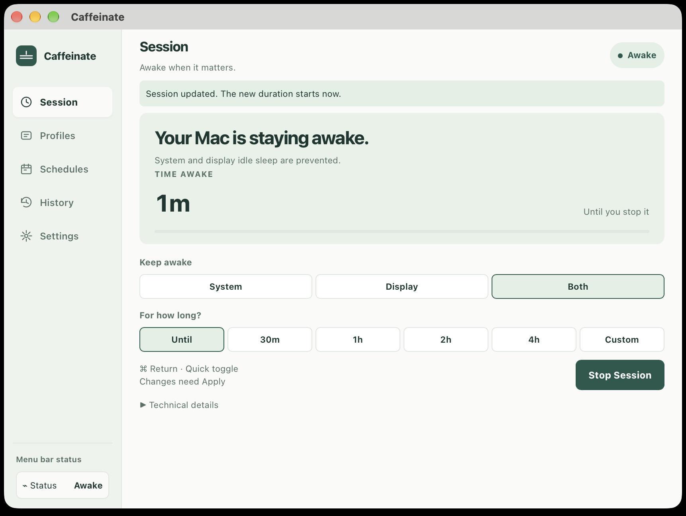
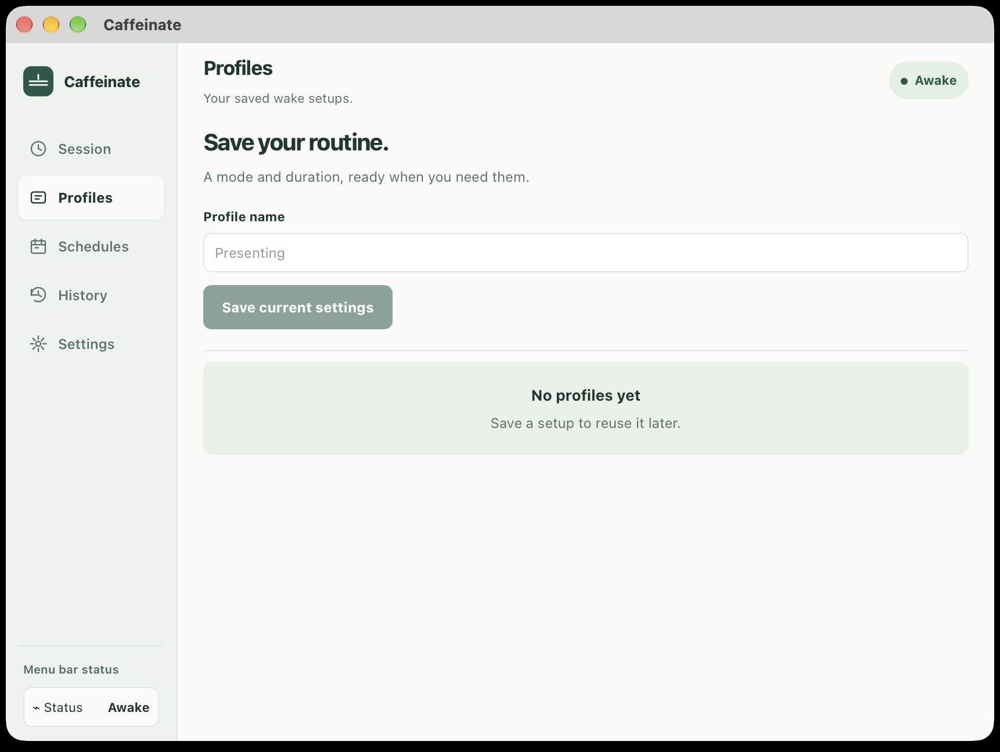
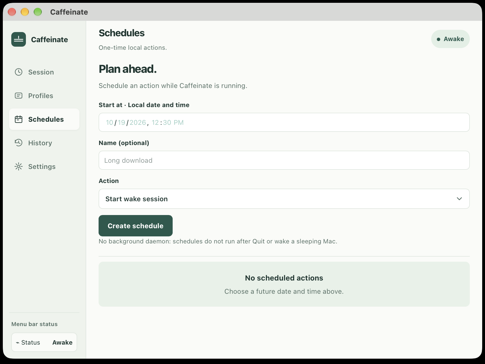
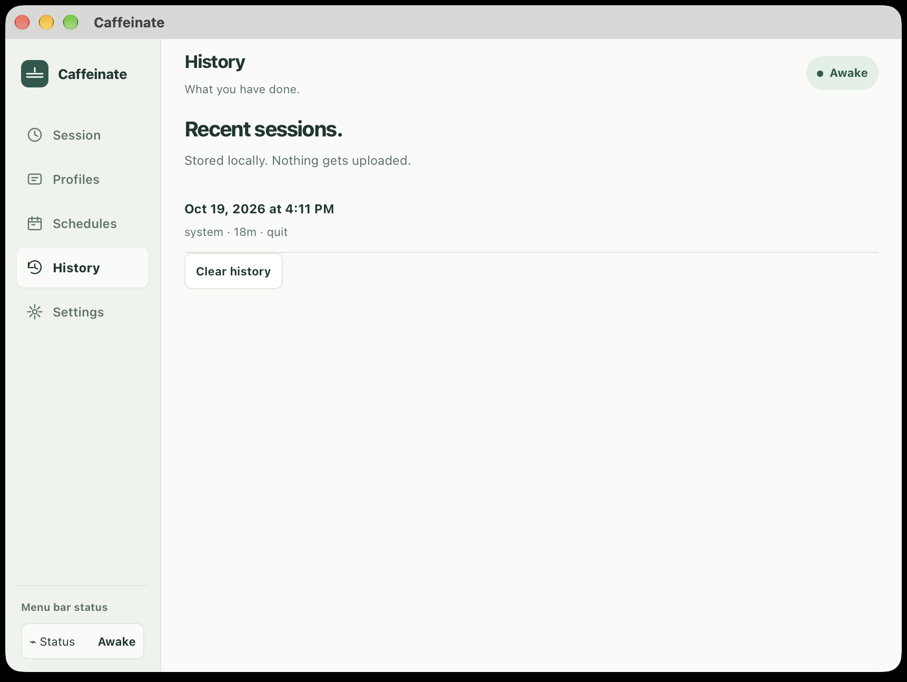
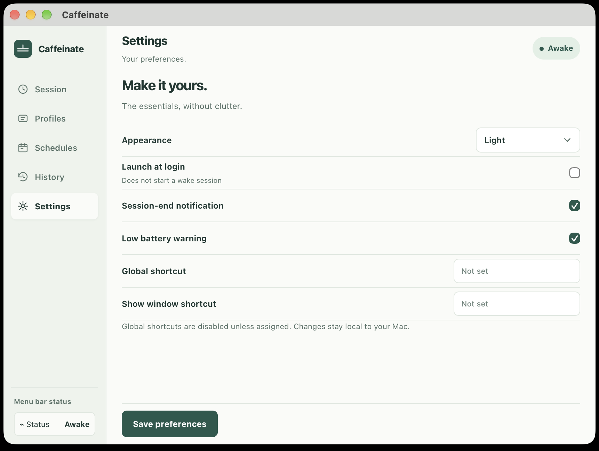
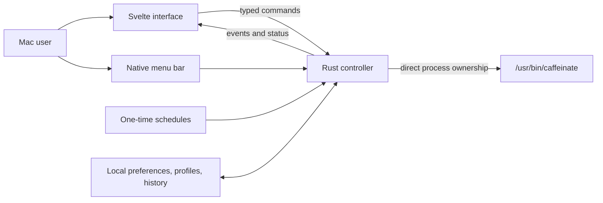

<div align="center">


# Caffeinate

**Awake when it matters.**

A quiet, local-first macOS app for keeping your Mac awake while your work finishes.

[Website preview](website/) · [Product video (Remotion)](marketing/remotion/) · [Published releases](https://github.com/AungMyoKyaw/caffeinate-app/releases) · [Report an issue](https://github.com/AungMyoKyaw/caffeinate-app/issues)

**Caffeinate 3.0.0-beta.0 · In development · macOS 12+**

</div>



## One purpose, done well

Builds take time. So do downloads, renders, presentations, and remote sessions. Caffeinate keeps your Mac awake without making you reconfigure your permanent system power settings.

Select what should stay awake, choose how long, and press **Keep Mac Awake**. Caffeinate manages the built-in `/usr/bin/caffeinate` command and shows when its assertion is active. Stop when you're finished, or let a timed session expire.

No account. No cloud synchronization. No telemetry.

## The interface

Every screenshot below comes from the actual macOS beta, captured on **19 October 2026**—not an HTML mockup.

|                                                             Session                                                             |                                                        Profiles                                                         |
| :-----------------------------------------------------------------------------------------------------------------------------: | :---------------------------------------------------------------------------------------------------------------------: |
|  |  |
|                                      Control System / Display / Both and session duration.                                      |                                      Reuse your preferred mode and timer settings.                                      |

|                                              Schedules                                              |                                           History                                            |
| :-------------------------------------------------------------------------------------------------: | :------------------------------------------------------------------------------------------: |
|  |  |
|                               Set up one-time start or stop actions.                                |                         Review and clear previous sessions locally.                          |

<details>
<summary><strong>View Settings</strong></summary>



</details>

Unedited original captures, the cropped PNGs, and website-optimized images are indexed in [the screenshot archive](docs/screenshots/v3/README.md).

## Features in 3.0 beta

- **System, Display, or Both:** prevent idle system sleep, display sleep, or both with typed options mapped to Apple's `-i` and `-d` flags.
- **A timer that fits your work:** until stopped, 30 minutes, 1 hour, 2 hours, 4 hours, or any custom duration from 1–1440 minutes.
- **Control a running session:** stage new duration or mode settings, then explicitly Apply or Discard.
- **Native menu bar:** close the window to hide it; use the menu to see status and control your session. Choosing Quit releases the owned assertion.
- **Profiles:** save, edit, apply, and remove your favorite configurations.
- **One-time schedules:** start or stop a session at a chosen local time while Caffeinate is running; edit, disable, or cancel upcoming actions.
- **Local history:** review recent completed sessions, then clear them when you want.
- **Preferences:** Light / Dark / System appearance, optional launch at login, notifications, low-battery warning, and configurable global shortcuts.
- **Keyboard friendly:** `⌘ Return` to toggle, accessible controls, visible focus, and reduced-motion support.
- **See the actual command:** an expandable technical details section exposes the owned `/usr/bin/caffeinate` invocation.

### Important boundaries

Caffeinate blocks _idle_ sleep; it **cannot override normal MacBook lid-close sleep**. One-time schedules execute only while the application runs—they cannot wake a sleeping Mac or run after Quit. Closing the _window_ leaves Caffeinate in the menu bar; **quitting the app** ends its owned assertion. There is no recurring background daemon or network service.

## Getting Caffeinate

### Published version

The 3.0 redesign is currently a **local beta**, not a publicly published 3.0 release. To install the existing published version instead, use [GitHub Releases](https://github.com/AungMyoKyaw/caffeinate-app/releases) or the published Homebrew cask:

```bash
brew install --cask AungMyoKyaw/homebrew-tap/caffeinate
```

The currently published version and the 3.0 beta may have **different UI and features**. The screenshots above show 3.0.

### Run the 3.0 beta from source

On a Mac with Xcode Command Line Tools, Rust stable, and Bun installed:

```bash
git clone https://github.com/AungMyoKyaw/caffeinate-app.git
cd caffeinate-app
bun install --frozen-lockfile
bun tauri dev
```

The public repository may not yet contain the local beta changes shown here. If working from the existing local project directory, run the final two commands there instead.

To build an Apple Silicon `.app` and DMG locally:

```bash
bun tauri build --bundles app,dmg --target aarch64-apple-darwin
```

For a universal Intel + Apple Silicon build, configure both Rust targets and run `bun run tauri:build`. Local beta bundles currently use ad-hoc signing; notarized public distribution requires a separately authorized release and Apple signing setup.

## Under the hood

Caffeinate uses **Tauri 2 + Rust** for the native window, menu bar, macOS process lifecycle, local storage, notifications, and scheduling. **Svelte 5 + TypeScript + Tailwind CSS 4** render the Stillwater interface. **Vite 8 and Bun** power development and production builds.



Rust invokes the **fixed absolute executable**, not a shell script, validates the wake mode and timeout, tracks the child it started, reconciles completion, and cleans up on Quit. The app-PID wait guard ensures an assertion doesn't survive an unexpected application exit.

There are no remote APIs, accounts, analytics SDKs, or external runtime services for normal app operation.

## Developer reference

| Task                        | Command                                                 |
| --------------------------- | ------------------------------------------------------- |
| Install dependencies        | `bun install --frozen-lockfile`                         |
| Native development          | `bun tauri dev`                                         |
| Format / check formatting   | `bun run format` / `bun run format:check`               |
| Lint and typecheck          | `bun run lint` / `bun run typecheck`                    |
| Frontend unit tests         | `bun run test`                                          |
| Rust unit tests             | `cargo test --manifest-path src-tauri/Cargo.toml --lib` |
| Frontend coverage           | `bun run coverage`                                      |
| Production frontend build   | `bun run build`                                         |
| Architecture contract       | `bun run verify:contract`                               |
| Validate website            | `python3 website/scripts/validate_site.py`              |
| Validate website references | `python3 website/scripts/check_links.py`                |

The frontend's **100% statements, branches, functions and lines** coverage threshold is intentionally strict and **not yet met** for this beta. The test suite passing does not mean every release gate is complete. See [UI audit and fixes](docs/redesign/UI-CONTROLS-AUDIT-FIXES.md) and the [approved 3.0 PRD](docs/redesign/PRD.md).

### Repository map

```text
src/                       Svelte app, styles, and frontend tests
src-tauri/src/             Rust wake controller, app lifecycle, local data
src-tauri/icons/           Horizon icon assets
docs/screenshots/v3/       Named real screenshots and archived originals
docs/redesign/             Product spec, design prototypes, QA evidence
website/                   Standalone static product website
scripts/                   Project validation and screenshot tools
```

Preview the redesigned website locally:

```bash
cd website
python3 -m http.server 8080
```

Then open `http://127.0.0.1:8080`. Website assets are checked into the repository and do not require a JavaScript build system.

To regenerate cropped / WebP screenshot variants after replacing the archived originals, install Pillow in your authoring environment and run:

```bash
python3 scripts/organize-v3-screenshots.py
```

This only regenerates derived screenshot assets; original captures are preserved.

## Support, contributing and license

Found a bug? [Open an issue](https://github.com/AungMyoKyaw/caffeinate-app/issues). Contributions are welcome; please read [CONTRIBUTING.md](CONTRIBUTING.md) and [SECURITY.md](SECURITY.md).

The project is available under the [MIT License](LICENSE).

---

<div align="center">
<sub>Made for the long things worth finishing. · © Aung Myo Kyaw</sub>
</div>
