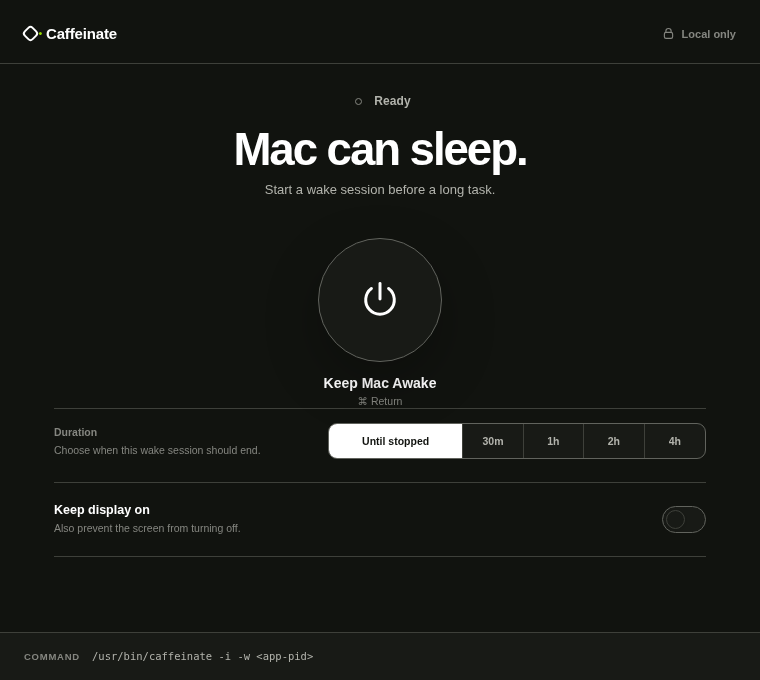
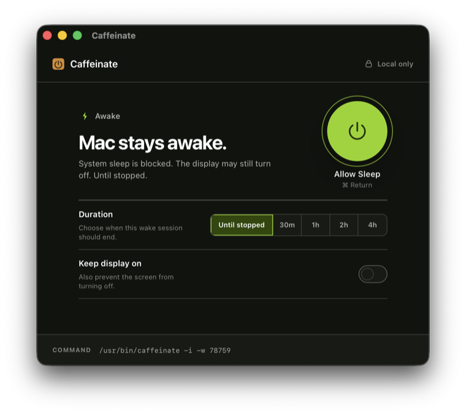
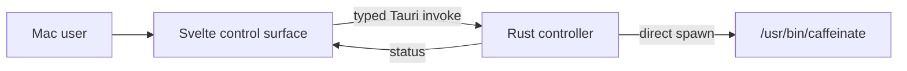

# Caffeinate for macOS

A lightweight Tauri + Svelte utility that owns macOS's built-in `/usr/bin/caffeinate` process so one wake session is easy to start, understand, and stop.

|                            Ready                             |                             Awake                              |
| :----------------------------------------------------------: | :------------------------------------------------------------: |
|  |  |

## Features

- Prevents idle system sleep with `caffeinate -i`.
- Optionally prevents display sleep with `-d`.
- Supports until-stopped, 30-minute, 1-hour, 2-hour, and 4-hour sessions.
- Uses `-w <app-pid>` so the assertion ends if Caffeinate exits unexpectedly.
- Reconciles natural timeout and cleans up on application exit.
- Shows the exact command Rust owns.
- Supports Command-Return, visible keyboard focus, reduced motion, increased contrast, and light/dark appearance.
- Runs locally with no account, telemetry, analytics, remote font, or network request.

Caffeinate is a normal macOS window. It is intentionally not a menu-bar utility and does not keep running after the app exits.

## Architecture

The Svelte frontend owns presentation and user intent. A small typed client invokes three Tauri commands. Rust remains authoritative for `/usr/bin/caffeinate` process ownership and lifecycle.



Detailed diagrams:

- [System context](docs/architecture/system-context.md)
- [Module and data flow](docs/architecture/module-flow.md)
- [Release flow](docs/architecture/release-flow.md)

## Technology stack

- Svelte 5 + TypeScript
- Tailwind CSS v4 (build-time utility framework via `@tailwindcss/vite`)
- Vite 8
- Tauri 2
- Rust
- Bun package management
- Vitest + V8 coverage
- ESLint + `eslint-plugin-svelte`
- Prettier + `prettier-plugin-svelte`

No UI kit, router, web-font package, icon package, state library, analytics SDK, or shell plugin is used. Tailwind CSS compiles down to a single small stylesheet at build time and does not add JavaScript to the runtime bundle.

## Requirements

- macOS 12 or newer
- Xcode Command Line Tools
- Rust stable toolchain
- Bun canary (1.4.0-canary.1)

Install Apple's command-line tools:

```bash
xcode-select --install
```

Then verify local tooling:

```bash
bun --version
rustc --version
cargo --version
```

## Installation

For local development:

```bash
bun install --frozen-lockfile
```

For an end-user build, use Homebrew or a release DMG once a verified release has been published.

```bash
brew install --cask AungMyoKyaw/homebrew-tap/caffeinate
```

## Development

```bash
bun install --frozen-lockfile
bun tauri dev
```

The Vite dev server binds to `127.0.0.1:1420`; Tauri loads it into the native application window.

## Configuration

There are no runtime environment variables, API keys, accounts, or remote services. Tauri configuration lives in `src-tauri/tauri.conf.json`.

## Common commands

| Task                       | Command                |
| -------------------------- | ---------------------- |
| Develop                    | `bun tauri dev`        |
| Format                     | `bun run format`       |
| Format check               | `bun run format:check` |
| Lint                       | `bun run lint`         |
| Type/Svelte check          | `bun run typecheck`    |
| Test                       | `bun run test`         |
| Coverage                   | `bun run coverage`     |
| Build frontend             | `bun run build`        |
| Package macOS              | `bun run tauri:build`  |
| Clean                      | `bun run clean`        |
| Full frontend verification | `bun run verify`       |

## Testing

Run the frontend suite:

```bash
bun run test
```

Run the Rust suite:

```bash
cargo test --manifest-path src-tauri/Cargo.toml
```

The frontend test guard rejects skipped, disabled, todo, and focused-only tests:

```bash
bun run test:focus
```

## Coverage

```bash
bun run coverage
```

Vitest is configured to require 100% statements, branches, functions, and lines for project-owned frontend executable code. Reports are emitted to `coverage/` in text, LCOV, JSON summary, and HTML formats.

## Build

```bash
bun run build
```

This runs `svelte-check` before the Vite production build.

## Packaging

Build a universal Intel + Apple Silicon `.app` and DMG:

```bash
bun run tauri:build
```

Expected paths:

```text
src-tauri/target/universal-apple-darwin/release/bundle/macos/Caffeinate.app
src-tauri/target/universal-apple-darwin/release/bundle/dmg/Caffeinate_2.0.0_*.dmg
```

The repository currently uses ad-hoc signing (`signingIdentity: "-"`). Public notarized distribution requires an Apple Developer signing/notarization setup.

## Usage

1. Choose a duration.
2. Optionally enable **Keep display on**.
3. Press the large wake control or Command-Return.
4. Confirm the UI says **Mac stays awake.** and inspect the command footer if needed.
5. Press the control again to allow normal sleep.

## Process model

The frontend never executes shell text. Rust directly starts only this fixed executable:

```text
/usr/bin/caffeinate -i [-d] [-t seconds] -w <app-pid>
```

Rust owns the child handle, reconciles `try_wait`, kills and waits on Stop, and calls cleanup during Tauri's `RunEvent::Exit`.

## Troubleshooting

**The app says it cannot start Caffeinate** — verify you are running on macOS. The backend intentionally rejects other platforms.

**The display still turns off** — enable **Keep display on** before starting the session. The safe default blocks idle system sleep only.

**A timed session ended by itself** — that is expected. Rust observes the child exit and the frontend reconciles back to Ready on the next status poll.

**Dependency install changes `bun.lock`** — do not commit an unexplained lockfile change. Verify the package manifest, regenerate with the pinned Bun release, and inspect the diff.

## Security notes

- No shell plugin or arbitrary command execution.
- No network API use, telemetry, analytics, or remote configuration.
- Fixed `/usr/bin/caffeinate` executable path.
- Timeout input is validated in Rust.
- The Rust process controller is the trust boundary for OS process lifetime.
- GitHub workflows use least-privilege read permissions for CI; release write permission is limited to the tag release job.

See [SECURITY.md](SECURITY.md) for vulnerability reporting.

## Lightweight evidence

See [docs/performance.md](docs/performance.md) for the baseline and measured rewrite footprint. The production dependency boundary is enforced by `scripts/verify-contract.mjs`.

## Design and project documents

- [PRODUCT.md](PRODUCT.md) — product truth and explicit non-goals
- [DESIGN.md](DESIGN.md) — Carbon + Volt design specification
- [RALPH_LOOP.md](RALPH_LOOP.md) — project-specific fast and release loops
- [RALPH_RUN_LOG.md](RALPH_RUN_LOG.md) — executed verification evidence and blockers
- `docs/superpowers/specs/` — design specifications
- `docs/superpowers/plans/` — implementation plans

## Contributing

Read [CONTRIBUTING.md](CONTRIBUTING.md). Keep changes inside the product scope: one local macOS wake-session control surface and one fixed OS command.

## Release process

1. Run the full release Ralph loop in `RALPH_LOOP.md` on macOS.
2. Confirm the 100% frontend coverage gate and Rust checks.
3. Build the universal `.app`/DMG.
4. Inspect signature and architecture.
5. Tag `v*`; the release workflow creates a draft GitHub release.
6. Review artifacts before publishing.

## License

MIT © [Aung Myo Kyaw](https://github.com/AungMyoKyaw)
