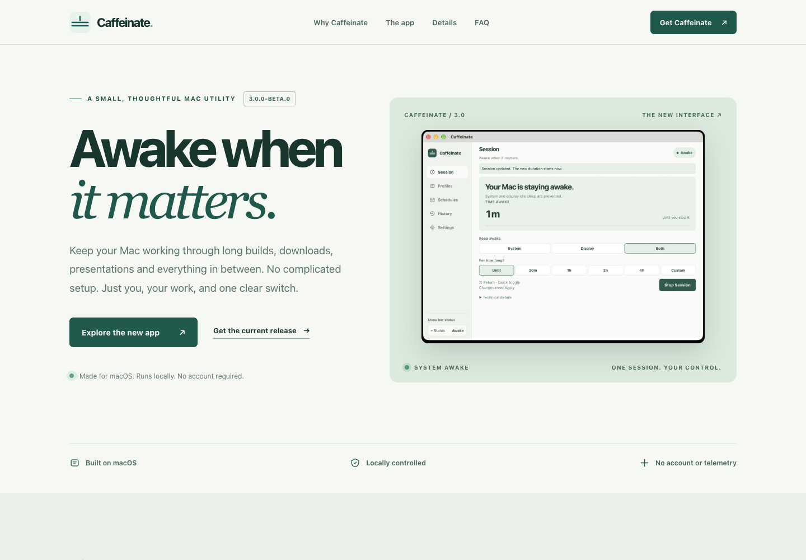

# Caffeinate product website

This directory is the **new Caffeinate 3.0 Stillwater product website**, rebuilt from scratch using five real native macOS screenshots. It is a dependency-free, responsive static site (HTML, CSS, vanilla JavaScript) with no analytics, font CDN, framework runtime, or build step.

## Preview locally

```bash
cd website
python3 -m http.server 8080 --bind 127.0.0.1
```

Visit [http://127.0.0.1:8080](http://127.0.0.1:8080).

The page contains a responsive hero, five-view keyboard-operable screenshot gallery, full-size image dialog, product details, installation information, FAQ, and mobile navigation. All screenshots are actual app captures.

## Verified desktop and mobile previews



[Full desktop page](docs/screenshots/website-desktop.png) · [Full mobile page](docs/screenshots/website-mobile.png) · [Screenshot gallery](docs/screenshots/website-gallery-desktop.png)

## Screenshot source of truth

- `../docs/screenshots/v3/originals/` — **unaltered** screenshots supplied by the user.
- `../docs/screenshots/v3/` — cropped, lossless native screenshot PNGs used by GitHub README.
- `assets/screenshots/` — optimized WebP crops for the public website.

The asset conversion is deterministic and preserves the raw captures. To regenerate after supplying replacement originals:

```bash
python3 ../scripts/organize-v3-screenshots.py
```

Requires Pillow for **authoring only**, not for serving the website.

## Version and availability configuration

Edit `site-config.js` to update version labels and the existing published release URL. The site currently previews **3.0.0-beta.0** but explicitly does **not** claim it is a public release. The published release version is configured separately, as is the existing Homebrew tap.

Don't point the website at an unpublished, unnotarized 3.0 DMG. Verify an actual release artifact and independently authorize publication before changing the distribution status.

## Validation

```bash
python3 scripts/validate_site.py
python3 scripts/check_links.py
node --check site-config.js
node --check script.js
```

Use Playwright CLI to inspect desktop, tablet, mobile, image gallery tabs, screenshots, keyboard behavior, nav menu, dialog and console errors. Visual design tokens and page structure are explained in [DESIGN.md](DESIGN.md).

## Hosting

Any static host, including GitHub Pages, can serve the contents of this directory. There is **no build step** and no application or release uploaded as part of website development. Hosting, deployment, tagging, commits, pushes and publication require separate authorization.
